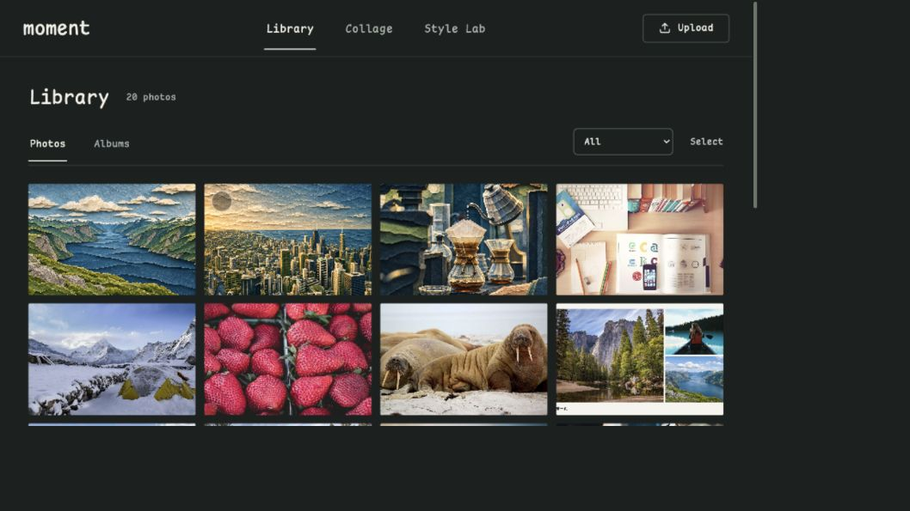
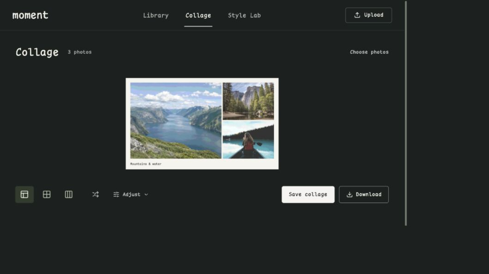

# moment

A private photo workbench prototype. Collect photos, compose albums and collages, and explore reusable AI styles.

## Run locally

Use Node.js 24 (the CI version) and npm.

    npm ci
    npm run dev

Open http://127.0.0.1:4173/.

    npm test
    npm run build
    npm run check

The production build is written to `dist/`. Design skills are optional and are not runtime dependencies.

## What works

- Upload JPG, PNG and WebP, or import bundled sample photos. Up to 20 files per batch, 12 MB per file.
- Browse and select photos; filter categories; manually classify or group using existing tags.
- Create albums, add notes and reorder photos. Export an album as self-contained HTML.
- Render collages, adjust spacing, background and caption, and save or download a real JPEG.
- Compare nine pre-generated examples: paper, clay and vintage comic applied to fjord, city and coffee photos.
- Save and reload named Style recipes, including prompt, composition preference and an optional reference image.
- Save supported sample results separately from their originals. Original and generated base images remain available through color adjustments.

## Prototype boundaries

This is a working frontend prototype, not a production cloud photo library.

- Photos, albums and Styles are stored in this browser's IndexedDB. They are not backed up or synced across devices or website origins.
- Grouping uses known tags. It does not run an image classifier.
- AI images were generated in advance. Arbitrary prompts and references can be saved, but live model generation is not connected. Editing an input without a matching example shows a pending state.
- There is no iCloud / PikPak connection, production sign-in, cloud upload pipeline or tens-of-GB capacity validation.
- HEIC, full Live Photos and videos are not supported.
- User-authored names, notes and prompts keep their language. The application controls use English / Sleet Mono, with Chinese fallbacks.

## Hosting

One repository supplies the same frontend to **Sites for the private workbench** and **GitHub Pages in demo mode**. The Pages build uses example data. The proposed Go service owns the real gallery business logic and can run locally, in Docker, or on a cloud host; it has not been implemented. Code stored on GitHub does not automatically deploy any of these services.

The existing Sites deployment is an earlier owner-private version. The current English frontend has not been deployed there. The Pages demo has not been published, and the existing personal homepage is unchanged.

See [DEPLOYMENT.md](DEPLOYMENT.md) for access, domains and the separation of code, hosting and photo storage.

See the [Sites + Go design draft](docs/superpowers/specs/2026-11-02-sites-go-gallery-design.md) for service boundaries, local/Docker/cloud deployment options and implementation milestones. This is a proposal, not a working backend or cloud deployment.

## Project guide

| Path | Purpose |
| --- | --- |
| `src/` | React UI, demo recipes, browser storage and image rendering |
| `public/` | Demo images, provenance records and the self-hosted font |
| `scripts/check-style-samples.mjs` | Sample eligibility, provenance and original-retention checks |
| `.openai/hosting.json` | Existing Sites identity and static output configuration |
| `.github/workflows/check.yml` | Build and sample checks; no automatic deployment |
| `PRODUCT.md`, `DESIGN.md` | Product boundaries and design decisions |
| `design-qa.md` | Historical visual and interaction verification |

See [asset notes](docs/ASSETS.md) for image sources, font licensing and optional design-tool provenance. Real browser captures shown above are illustrative; they do not connect to a live gallery.
