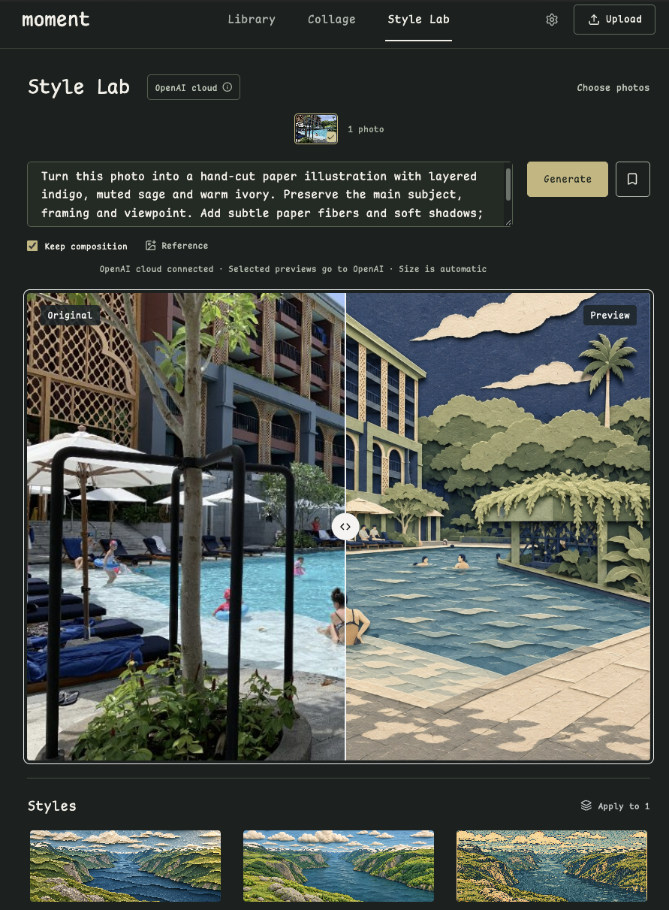

<h1 align="center">Moment Studio</h1>

<p align="center">A private photo workbench for organizing your library, making collages, and turning a prompt into a new image.</p>

<p align="center">
  <a href="https://sleepylgod.github.io/moment-studio/"></a>
  <a href="DEPLOYMENT.md#deploy-your-own-copy"></a>
</p>

<p align="center">
  
  <br>
  <em>Style Lab in the private workspace. The original is on the left and the generated edit is on the right.</em>
</p>

## What you can do

- **Organize your library.** Import still HEIC, JPEG, PNG and WebP. Browse by month, group recent photos with AI tags, and build your own albums.
- **Make a collage.** Arrange selected photos, adjust the layout, and save the result as a new image.
- **Create a Style.** Pick a photo, describe the edit, and compare the result with the original. Save the prompt and an optional reference as a reusable Style.
- **Manage originals.** Download the original file, restore photos from Trash, or review what each permanent deletion would affect before confirming.

## Demo and private workspace

| | Public demo | Private workspace |
| --- | --- | --- |
| **Photos** | Bundled examples and browser-local imports | Your own uploads in an owner-only cloud library |
| **Style Lab** | Interactive comparison with pre-generated results | Live prompt-based editing through a connected OpenAI cloud task |
| **Storage** | This browser | D1 metadata and R2 files through ChatGPT Sites |

The [public demo](https://sleepylgod.github.io/moment-studio/) is ready to try without signing in. With source access, you can [deploy an independent workspace](DEPLOYMENT.md#deploy-your-own-copy) with its own storage and AI connections.

## Run locally

Use Node.js 24 and npm.

```sh
npm ci
npm run dev:demo
```

Open `http://127.0.0.1:4173/`. Run `npm run check` for tests, TypeScript and both builds.

## Documentation

- [Deployment](DEPLOYMENT.md) · GitHub Pages, private Sites, and local cloud simulation
- [Developer guide](docs/development/README.md) · Architecture, AI connections, and verification
- [Photo import](docs/development/heic-import.md) · Formats, orientation, and capture dates
- [Assets and credits](docs/ASSETS.md) · Bundled samples and fonts
- [Later work](TODO.md) · Export, recovery, and other open work
