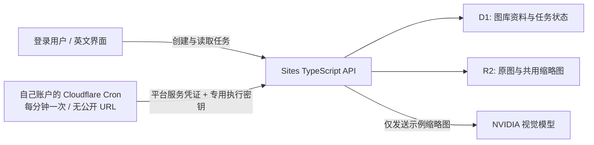
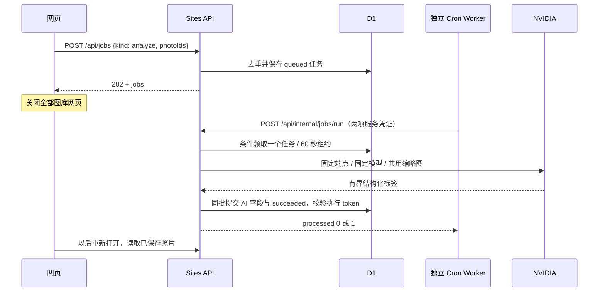

# 云端后台验收

2026-11-03，时间使用 UTC。只处理项目咖啡示例；没有接入个人图库。

## 当前部署

这张图表示已部署的任务切片；月份查询、自动分组、模型目录刷新与实时生图仍是后续工作，不代表已实现。

## 已观察事实

- OAuth 已成功，Cloudflare 账户为用户确认的 `87970424ed87ee8b8a7a305097f8e8d4`。只请求账户/用户读、Workers/脚本写、日志读及 OAuth 后台访问。
- 新账户先打开 Workers & Pages，平台自动初始化账户子域名。执行器 `workers_dev=false`，没有启用公开 URL，也没有 DNS、D1/R2 或跨账户绑定。
- 执行器 `moment-photo-executor` 已部署，两个运行凭证以加密 secret 输入。控制台实际保存 `* * * * *`；不是只检查本地配置。
- Sites v6，源码 `f2d576cc8553df792b14a5017a0418d8736c5d39`，生产环境修订 2，07:50:50 发布成功。迁移 0003 创建了 jobs 表；原有记录保留。
- 携带平台服务凭证，缺少/错误执行密钥调用 runner 均为 401；正确密钥为 200、processed=0。相同平台凭证访问 `/api/me` 和私有原图仍为 401，不拥有用户身份。
- 07:51:51，登录用户经 UI 为咖啡示例创建任务 `<private record ID>`，随后关闭全部图库页。独立 D1 读取观察 queued、attempts=0。
- 07:54:15，实际 Cron 事件触发，但 Worker 抛出 `Invalid redirect value`。Cloudflare 接受 follow/manual，不接受 error。任务仍 queued、attempts=0，没有假成功。
- 根因修复：执行器及 NVIDIA 请求改为 manual，任何非 200 的重定向均拒绝；不把凭证或图像转发到另一个源。回归先观察失败，再修复通过。新增执行器与模型的 302 拒绝检查。

## 修复后的实测结果

- Sites v7，源码 `95a1fee51a4990698fe628a85ff74fd17276bc45`，部署 `<private release ID>`，环境修订 2，07:58:05 发布成功。执行器版本 `<private record ID>`，相同 Cron 配置。
- 07:58:15 实际 scheduled 事件，outcome=ok、processed=1；墙钟 5947 ms、CPU 1 ms。这是单次观察，不是速度承诺。调用期间所有图库页仍关闭，网页轮询没有参与执行。
- 07:58:21 D1 任务为 succeeded、attempts=1，结果为「咖啡壶、滤纸、手冲」，简述「倒入热水冲煮咖啡」。同一个 photo 保存相同 AI 字段和 jobId，原来的人工分类「旅行」、原图引用、共用缩略图引用保留。
- 在新标签重新打开图库，照片预览显示 AI 标签和原来的 Travel 分类。通过登录用户的 Download original 下载文件，其 SHA-256 与项目 `1060.jpg` 完全相同：`82586f13e519cddd91b3b9a3790d088127e3b22cb882feef8c56ca639d7be6d2`。
- 另外导入项目 `1067.jpg` 城市示例（命名 `moment-cron-overlap-example`），经 owner UI 创建任务 `<private record ID>`。08:01:02 同时提交两次经过认证的 runner 请求，均 HTTP 200，processed 分别为 0 和 1。D1 该任务 succeeded、attempts=1、结果为「摩天大楼、城市天际线、日落」。
- 本地 30/30 测试、TypeScript、Sites 和静态 demo 构建通过；GitHub 对 `95a1fee` 的 CI `41599893256` 通过。先前独立审查的两个重要问题已修复，实际 Cloudflare 重定向差异也有回归。
- 城市示例完成后再次点击 AI tags，D1 仍只有上述两条任务，各 attempts=1；重复提交没有新增任务。可复查[脱敏结果记录](evidence/2026-11-03-cloud-executor.json)。

## 验证边界

关闭网页、真实定时触发、生产 Sites 到 NVIDIA、D1 写入和重新打开读取已通过；不是模拟结果。第一次失败记录保留，部署成功不替代功能验收。

云端过期租约恢复尚未故障注入。有限重试、过期租约重领、旧执行 token 拒写及重试耗尽仅由本地 SQLite 与伪提供方测试验证。没有为验收添加生产 SQL 写入接口或匿名调试接口，也不宣称供应商 exactly-once。

目录刷新和上次成功模型策略尚未实现到网站；当前任务冻结已验证的单一 Nemotron 模型。Style Lab 继续使用预生成示例，没有实时图像编辑服务。该切片不自动生成相册，也不处理真实图库。

## 来源

- [Cloudflare Cron Triggers](https://developers.cloudflare.com/workers/configuration/cron-triggers/)：配置传播最多约 15 分钟，事件列表显示可能延迟更久。
- 生产 D1 的只读 Sites 查看器、实际 Wrangler 部署与 scheduled 日志、登录用户 UI 操作。
- [此前本地 NVIDIA 实测](execution-verification.md)与[任务实施计划](cloudflare-executor-plan.md)。密钥、图片 base64、账户认证文件不属于证据文件。
