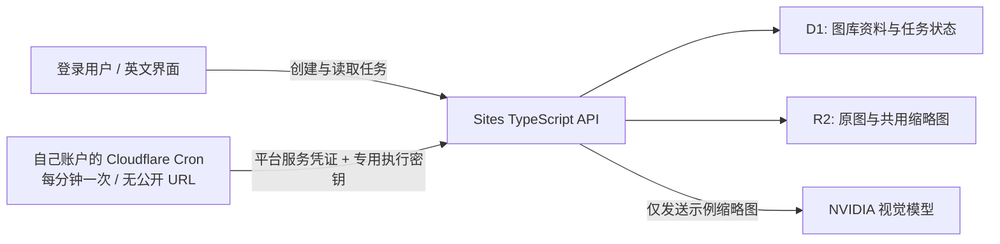
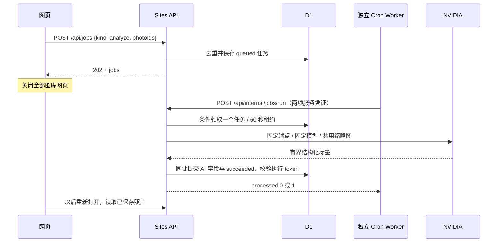

# 云端后台验收

2026-11-03，时间使用 UTC。只处理项目咖啡示例；没有接入个人图库。

## 当前部署

这张图表示已部署的任务切片；月份查询、自动分组、模型目录刷新与实时生图仍是后续工作，不代表已实现。

## 已观察事实

- OAuth 已成功，Cloudflare 账户为用户确认的 `87970424ed87ee8b8a7a305097f8e8d4`。只请求账户/用户读、Workers/脚本写、日志读及 OAuth 后台访问。
- 新账户先打开 Workers & Pages，平台自动初始化账户子域名。执行器 `workers_dev=false`，没有启用公开 URL，也没有 DNS、D1/R2 或跨账户绑定。
- 执行器 `moment-photo-executor` 已部署，两个运行凭证以加密 secret 输入。控制台实际保存 `* * * * *`；不是只检查本地配置。
- Sites v6，源码 `f2d576cc8553df792b14a5017a0418d8736c5d39`，生产环境修订 2，07:50:50 发布成功。迁移 0003 创建了 jobs 表；原有记录保留。
- 携带平台服务凭证，缺少/错误执行密钥调用 runner 均为 401；正确密钥为 200、processed=0。相同平台凭证访问 `/api/me` 和私有原图仍为 401，不拥有用户身份。
- 07:51:51，登录用户经 UI 为咖啡示例创建任务 `b6065d61-cf11-4a62-8d9a-e36eae89992d`，随后关闭全部图库页。独立 D1 读取观察 queued、attempts=0。
- 07:54:15，实际 Cron 事件触发，但 Worker 抛出 `Invalid redirect value`。Cloudflare 接受 follow/manual，不接受 error。任务仍 queued、attempts=0，没有假成功。
- 根因修复：执行器及 NVIDIA 请求改为 manual，任何非 200 的重定向均拒绝；不把凭证或图像转发到另一个源。回归先观察失败，再修复通过。新增执行器与模型的 302 拒绝检查。

## 尚待完成

- 发布重定向修复，并观察真正的 Cron → Sites → NVIDIA → D1 成功链路。
- 重新打开图库，读取标签；下载原图比较 SHA-256。
- 云端重复提交/重叠执行；记录租约故障恢复的验证范围。

本地测试、模拟与实际云端结果分开记录。当前不把部署成功或 Cron 已触发视为模型识图成功。

## 来源

- [Cloudflare Cron Triggers](https://developers.cloudflare.com/workers/configuration/cron-triggers/)：配置传播最多约 15 分钟，事件列表显示可能延迟更久。
- 生产 D1 的只读 Sites 查看器、实际 Wrangler 部署与 scheduled 日志、登录用户 UI 操作。
- [此前本地 NVIDIA 实测](execution-verification.md)与[任务实施计划](cloudflare-executor-plan.md)。密钥、图片 base64、账户认证文件不属于证据文件。
