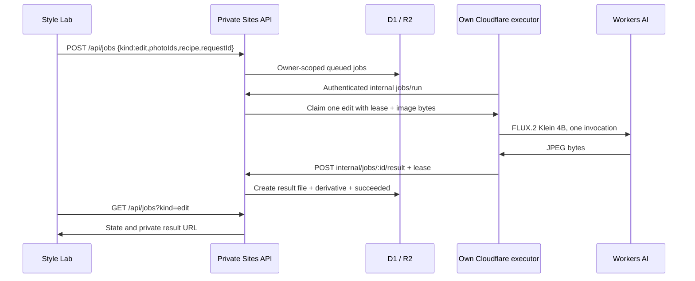
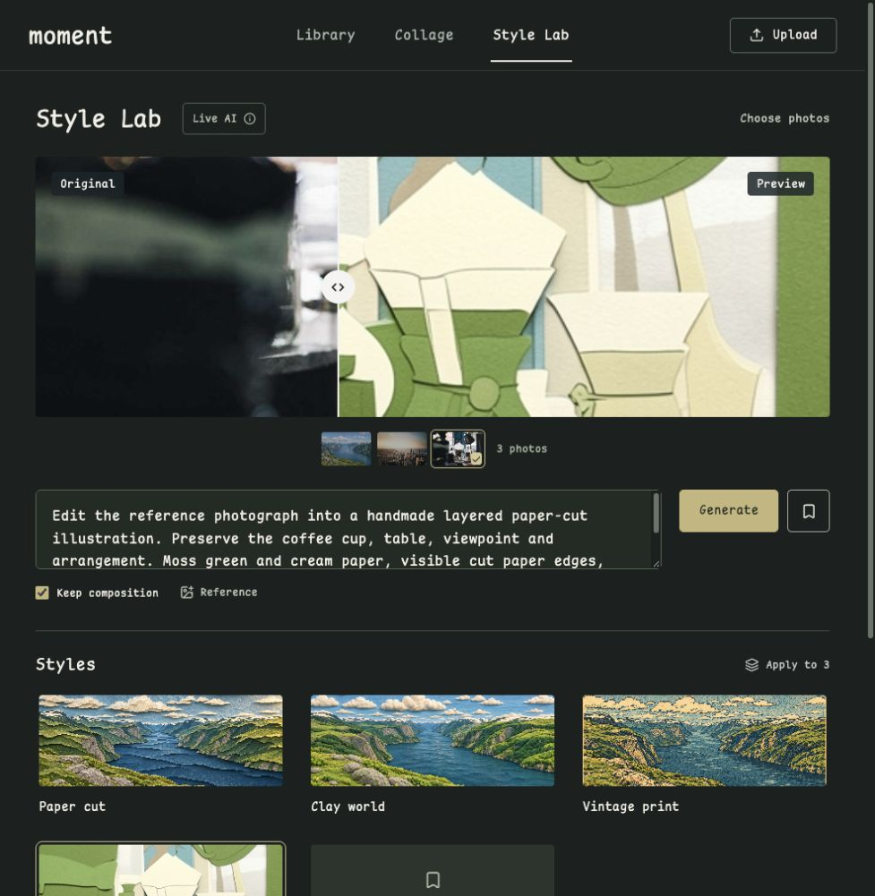

# Cloudflare Style Lab

Verified 2026-11-03. The account dashboard shows **Workers Free / Current plan**. No Paid upgrade, billing change or paid fallback was enabled. Workers AI currently includes 10,000 neurons/day, shared across the account. Free stops at that allocation; upgrading the account later would change this boundary.

## Why this endpoint

Image + text input can produce text tags or edited image bytes. The NVIDIA analyzer already used here produces tags. NVIDIA’s FLUX.2 Klein preview currently documents preset `image` IDs 0–3, whereas Cloudflare’s tested endpoint accepts supplied image bytes. This is a hosting-interface difference, not a claim that NVIDIA models cannot edit photos.

## Actual trials

The first two calls edited the bundled public coffee photograph (`public/photos/1060.jpg`) into layered paper. No private user photo was sent. Fixed output: 512×512 JPEG; prompt + input image, seed 42.

| Input | Actual provider time | Output bytes | Dashboard cumulative neurons |
| --- | --- | --- | --- |
| 480×373 | 2,537 ms | 188,685 | 107.87 |
| 768×597 | 3,266 ms | 185,873 | 217.43 |

A third call through the deployed Style Lab succeeded on the unmodified 900×700 bundled coffee photo; dashboard cumulative **326.98 neurons** afterward (observed increase109.55). It created job `<private record ID>`, one512px JPEG and a D1 derivative. Original download hash matches the repository source.

Metering is the dashboard observation after each trial, not a usage field from the response (none was returned). The second observed increase is 109.56 neurons; it is not a promise of fixed per-image cost. Existing 768px previews were accepted, so no additional persistent AI-input image is needed. The effect resembles cut paper, but composition fidelity is approximate.

## Components and interface

- `POST /api/jobs`: `kind=edit`, 1–20 owner-original IDs, a nonempty prompt ≤1,500 chars, preserve flag, optional owned reference, stable request ID. Same request returns the existing task; changed payload returns 409.
- `GET /api/jobs?kind=edit`: all unresolved owner edits plus the latest 20 records; history cards remain limited in the UI. Overlapping pending edits for the same original/recipe are rejected transactionally.
- Internal runner and result routes require both the private Site boundary and the existing dedicated executor key. Result upload additionally requires its current lease. No browser model secret, public R2 URL, provider URL fetch or second task database is introduced.
- `MOMENT_IMAGE_EDIT_ENABLED=true` and the existing background flag/key enable this profile. Production executor uses an AI binding; no additional OAuth scope is required for the tested deployment path. It retains `workers_dev=false` and no routes.

The executor tries inference once. It may retry delivery of those same result bytes twice; it never regenerates on an ambiguous timeout. Expired execution becomes `unknown`; no automatic cross-provider/paid fallback. Provider quota failure becomes a visible failed task.

## Storage and UI

Input uses the existing upright preview; reference uploads are reduced in the browser. A completed edit adds one 512px JPEG to R2 and one derivative linked to the original in D1. That small result doubles as its display preview. Originals and manual albums are untouched; no extra full-size intermediate or result thumbnail is stored. Job input stores paths/recipe, not image bytes. File reads remain owner-authenticated.

Style Lab enables Generate, original comparison, reusable saved recipes, batch application and the recent four task cards. Results save automatically. `unknown` never appears as success. The standalone static demo keeps its nine explicitly pre-generated examples.

## Validation status

- Actual Cloudflare AI-bound inference: the two trials above passed. Temporary validation endpoint was disabled afterward.
- Local SQLite/mocked R2: owner isolation, stable request IDs, source/album preservation, wrong/expired leases, truncated JPEG, one result file, duplicate completion, quota/unknown state and result delivery retry are covered.
- Local production-built Worker with real local D1/R2: bundled asset read, idempotent queue and simulated completion using the actual probe JPEG passed. This did not invoke the model. Vite development asset fetch did not pass; the built Worker binding did.
- Fresh final code review found two duplicate-generation paths; both reproduced RED then passed GREEN after transaction-level overlap checks and restoring all unresolved tasks. Full suite: 61/61, TypeScript and both builds passed.
- Hosted Style Lab: Generate → Cron inference → private R2/D1 result → original comparison → download SHA check → Save Style → reload and reselect saved recipe passed. Queue state also survived a reload. Three manual albums retained their previous revisions/timestamps. Service-only requests without visitor identity could not read files (401), and missing executor keys returned401.
- Hosted batch/reference-image generation, an entirely closed-browser image inference and cloud fault injection were not exercised. Backend/executor tests cover overlap, state restoration and result delivery separately.
- Large-scale queue throughput, high-resolution quality, cloud fault injection and account-wide automatic metering are not claimed.

## Official references

- [Cloudflare model](https://developers.cloudflare.com/workers-ai/models/flux-2-klein-4b/)
- [Multipart reference-image API](https://developers.cloudflare.com/changelog/post/2026-01-28-flux-2-klein-9b-workers-ai/)
- [Workers AI pricing and Free cap](https://developers.cloudflare.com/workers-ai/platform/pricing/)
- [NVIDIA FLUX.2 preset-image contract](https://docs.api.nvidia.com/nim/reference/black-forest-labs-flux_2-klein-4b-infer)

[Machine-readable evidence](evidence/2026-11-03-cloudflare-edit.json). Account usage is a snapshot shared by all Workers AI calls; future costs depend on dimensions and shared usage.
