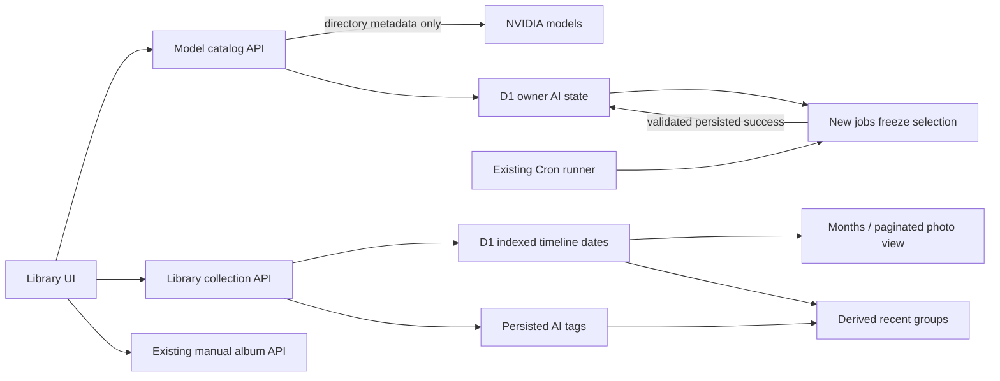

# Models, months and recent groups

2026-11-03 · Local and hosted example acceptance passed; exact scope below.

## Current behavior

- On each cloud-page load, the UI reads persisted model status and refreshes NVIDIA's directory once. The small refresh button repeats that action. Directory refresh never sends images or runs inference. Concurrent requests in one isolate share an in-flight read; no cross-isolate exactly-once claim is made.
- Only registered, example-verified profiles are eligible. Currently this is `nvidia/nemotron-3.5-super-vl-120b-a12b`. Directory IDs alone do not prove health or entitlement. The last successful eligible model wins, otherwise the first verified eligible profile is selected. Empty compatible results disable new work; failures retain the previous catalog and show an error.
- The owner record stores only small catalog IDs/timestamps and last validated success. Migration 0004 recovers the most recent prior successful model. New jobs freeze their selection; directory changes never rewrite queued/completed jobs. Saved success and preference update share the fenced D1 transaction. There is no model scanning or automatic paid fallback.
- Library has **Photos / Months / Recent / Albums**. Month cards count the entire owner-scoped library and open the existing paginated photo list. Category filtering still applies. Month summaries are paginated too; resolving card covers does not mark those extra photos as visible in the current photo page.
- The calendar is `Asia/Hong_Kong`. Explicit zoned `capturedAt` wins, then a valid stored photo date, otherwise server import time. Current uploads use the file-modified date, not EXIF capture time; previews label the source. Migration 0005 backfills indexed dates without changing existing JSON, photo revisions or albums.
- Recent reads at most 300 original-photo records dated within the last 30 calendar days. Shared normalized AI tags take priority, same-day leftovers form date groups. Each photo occurs in at most one group; groups contain 2–20 photos. A bounded-view indicator appears when more than 300 originals qualify. Singletons are not shown as groups.
- Recent groups are derived reads from persisted metadata: no group table/job, confirmation inbox, album membership/order changes, extra inference calls or image copies. A group may change as dates/tags change. Manual albums remain separate, editable only through their existing explicit actions.
- Static demo uses the same pure calendar/grouping functions, with no NVIDIA credentials or production API requests. Style Lab remains pre-generated examples.

## Interfaces

| HTTP | Result / boundary |
| --- | --- |
| `GET /api/ai/models` | Persisted supported candidates, selection reason, directory check time and last success; no key |
| `POST /api/ai/models/refresh` | Bounded authenticated NVIDIA metadata read; explicit 503 on transport/auth/invalid directory, no fake fresh result |
| `POST /api/jobs` | Existing analyze contract, now selects/fixes model from catalog; duplicate existing work is returned without reselection |
| `GET /api/photos?month=YYYY-MM&category=...&cursor=...` | Indexed month filtering with existing stable `(created_at,id)` cursor and scoped counts |
| `GET /api/photos/months?category=...&cursor=YYYY-MM&limit=50` | Descending month summaries `{month,count,coverId}` and next cursor, at most 50 per page |
| `GET /api/groups` | Derived recent groups, window, scanned count and truncation flag; readonly |

All routes require the existing authenticated owner and reject foreign identities. The executor key still authorizes only the internal runner, never these gallery reads.

## Verification

- RED→GREEN: model routes/selection, malformed refresh and removed candidates, concurrent refresh, old success backfill, frozen jobs and invalid-output preference protection.
- RED→GREEN: calendar month boundary and invalid dates, month/category counts and cursors, recent window/bounds/determinism, manual-album equality, legacy migration preservation, client visibility after a date moves out of its month.
- 44/44 tests, TypeScript, nine sample provenance checks, Sites and static-demo builds passed locally. Existing local Workers upload/download/auth/re-login smoke test passed after applying migrations 0003–0005. The independent review's important slow-filter race was fixed with a delayed-response regression for both category/month action orders.
- Browser: month cards → filtered photos → Recent cards → readonly detail; 390px viewport `scrollWidth=clientWidth=379`, all four tabs visible. Temporary viewport reset.
- Production evidence is separate from the local checks: see the actual hosted observations below.

### Hosted acceptance (UTC)

- Private Sites v9, source `595fd4e14ce6dd17f54235091e9f3880d50afdcd`, deployment `appgdep_6ae99f365c9c81918a19b108b282b99f`. Environment revision 2, existing Cron unchanged; migrations 0004/0005 applied successfully. Feature-branch CI `41605511136` passed.
- Initial page load refreshed the real NVIDIA directory at 08:46:58; manual refresh updated it at 08:47:39. Both selected the previously successful Nemotron profile. After reload, the check time advanced to 08:53:12 while last success remained persisted. No inference call is used to refresh the directory.
- Uploaded one public `1067.jpg` example named `moment-model-preference-example`. Job `5db1ad66-ace6-4e9e-a7d1-3eaa311fe768` froze the selected Nemotron model, then the existing scheduled runner saved a valid result at 08:50:18 with attempts=1. Owner `lastSuccessAt` matched that saved time. Tags: 摩天大楼、城市天际线、日落. No personal photo was submitted to the model.
- Months before the new example: November 2026=4, October 2026=12, September 2025=1. Browser displayed those cards. Recent directly displayed a 2-photo AI-tag group 城市天际线 plus same-day groups; opening it showed both photos without a confirmation step.
- New photo preview identified `2026-11-03 · file date`. Downloaded original SHA-256 matched bundled/uploaded bytes: `477c3915d130a726c98dfae661e80a95a91d1affef24bfd6293e8aa68696a039`.
- D1 comparison before/after migration, refresh, inference and collection reads: all 3 manual-album rows, revisions and order were exactly unchanged; all 17 pre-existing photo JSON/revision/timestamps were unchanged. Only the named acceptance photo was added. No empty indexed dates remained.
- Platform service access without user identity returned 401 for model read/refresh, months and groups. Owner-private publishing preserved audience. [Sanitized observation record](evidence/2026-11-03-models-organization.json) contains no credentials or private album contents.

## Remaining boundaries

One inference profile is registered today. Multi-model preference is a tested selection contract, not evidence that a second NVIDIA endpoint is currently callable. EXIF extraction, manual tags/exclusions, full-library clustering, live image editing and cloud lease-interruption fault injection are outside this change. No original or saved creation is deleted.

Deferred minor from review: migration's fixed UTC+8 differs from IANA historical Hong Kong DST. A legacy zoned capture at `1979-05-31T15:30:00Z` can shift May→June on a subsequent edit. This does not affect current 2026 records; it is tracked before legacy/EXIF onboarding.
