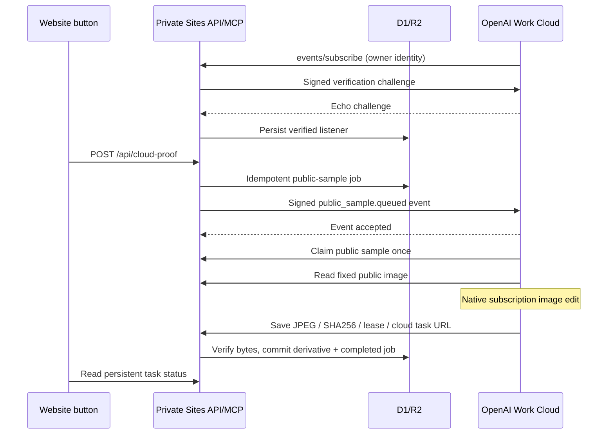

# Website-triggered OpenAI subscription image proof

**Hosted click-to-result acceptance passed on 2026-11-04 (Asia/Hong_Kong).** One actual click on `/cloud-proof` delivered an MCP event, automatically started the connected OpenAI cloud task, generated a fresh image using the native subscription tool and saved it into private Sites D1/R2. No follow-up message or manual task run performed the work. Closing the validation tabs did not stop processing. This is a fixed public-sample proof, not yet the general Style Lab provider.

## Architecture and boundary

The owner clicks **Generate public sample**. Sites commits one public-coffee job and sends a signed MCP event to an already connected OpenAI Work Cloud listener. The listener claims the job, reads the fixed source, edits it using the native image tool and saves actual output bytes through the Site MCP tool. No Mac process, paid API, new cloud service, private-photo input or manual-album write is involved. The existing own-account Cloudflare analyzer/editor executor does not process this job kind.

One-time OpenAI listener setup is required; publishing an MCP server does not create a task. The listener remains enabled. A missing or expired connection blocks new queue creation. Event acceptance and final storage are separate states: accepted delivery alone is never reported as a completed edit.



## Parameters and the actual failure

The original complete task request works after correcting our Site code:

```json
{
  "title": "Moment public sample image editor",
  "schedule": "",
  "timing_mode": "condition_watch",
  "triggers": [{
    "connector_id": "asdk_app_sites_b9b46a1a49788191878618b24fcd671b",
    "event": "public_sample.queued",
    "params": {}
  }]
}
```

The task also receives processing instructions. The native create declaration requires both timing fields and explicitly describes the empty schedule for webhook tasks; a later paragraph says to omit them. Omitting them failed argument binding. This documentation inconsistency does not establish that the complete request was wrong or that OpenAI was unavailable. After our fixes, that same complete request created task `6aea0e6875d88191be38d334306d2d88`, enabled, with stored `X-UNSCHEDULED:1` and no next scheduled run. The official task edit dialog independently showed the Moment connector and `public_sample.queued` trigger.

Three issues in our implementation were identified:

1. **Unsupported Workers request option.** `redirect: "error"` throws before HTTP transmission in workerd. Changed to `manual`, retaining explicit rejection of redirects/non-2xx responses. A real Miniflare/workerd regression test fails on the old code and passes after correction, including a controlled HTTP 302 response. This is runtime evidence, separate from the live OpenAI run.
2. **Missing actual callback origin.** Persistent, owner-readable setup diagnostics revealed an authenticated subscription rejected with `origin_not_allowed` for `https://connectors.api.openai.com`. Added that exact observed first-party host to the allowlist; no wildcard or arbitrary URL support.
3. **Cleanup hid the primary failure.** Unsubscribe cleanup overwrote the last subscribe diagnostic. Only subscribe setup now updates this bounded diagnostic. It contains phase/reason/origin, never secrets or callback URL tokens.

The previous attribution to an OpenAI service problem was premature. The earlier [failed-state evidence](evidence/2026-11-04-openai-event-trigger.json) is retained as historical evidence; its blocked status and resume instructions are superseded by this acceptance.

## Interfaces and state

- MCP advertises `events` and implements `events/list`, `events/subscribe`, `events/unsubscribe`.
- `public_sample.queued` has no selectable filters; payload contains job ID and fixed photo ID `1060` only.
- `public_cloud_connection` returns readiness, expiry and last safe setup diagnostic. `public_sample_image` exposes the checksum-verified bundled JPEG, not arbitrary gallery files.
- Claim/save tools enforce owner identity, one claim, fenced commits, byte verification and idempotent delivery. Task instructions require native image editing once, checksum verification and readback after saving. Unknown inference outcomes must not trigger automatic re-generation.
- One listener row per owner lives in `cloud_event_subscriptions` (migration `0007_new_the_leader.sql`). Secrets remain server-side. Default/maximum subscription lifetime is 24 hours. OpenAI must refresh before expiry; long-term automatic renewal has not yet been observed.
- Only fixed first-party HTTPS callback hosts are accepted; credentials, custom ports, fragments, arbitrary subdomains/IPs and redirects are rejected. This is not a general callback fetcher.
- Standard Webhooks HMAC covers event ID, signing timestamp and exact body. Verification challenges are random, bounded and compared without value-dependent early exit. Key rotation signs with both keys for five minutes.
- The button request awaits bounded delivery: at most three transient retries with stable event ID/body, persisted delivery lease and no resend after acceptance. Failed delivery retries the same job. No `waitUntil`, Mac poller, own-account executor, new queue or clock schedule is used for this route.
- The event-proof key is separate from the earlier manually started proof. Each owner gets one fixed public-sample job; repeated clicks return its current result. Real-photo selection, arbitrary prompts and batching are not implemented here.
- R2 stores one final JPEG used for this proof's preview and download. D1 links the derivative to source `1060`. No additional full-size intermediate or duplicate preview is saved to R2.

## Hosted acceptance

Live code: `a5f83dd9942bc70c691991becca74d7435b2407f`, Site version 22, deployment `appgdep_6aea0e0189ec819186fc79e81cc80057` succeeded, owner-private access preserved.

| Check | Observed result |
| --- | --- |
| Before click | Native MCP job status null; connection ready with setup `configured` |
| Actual website click | Clicked Generate exactly once; signed event accepted with HTTP 200 |
| Automatic execution | Native MCP status became running without another prompt or manual Run now |
| Closed validation pages | Site and setup-chat verification tabs closed while processing; completion still arrived |
| Cloud completion | Job `b18be5ea-0286-4290-81fc-bf90b0e70b98` succeeded; automatic cloud run reported native image editing once |
| Reopened Site | New image loaded at natural dimensions 1422 × 1106, 587,354 bytes |
| Authenticated download | Downloaded file SHA-256 equals saved result SHA-256 below |
| Manual albums | All 3 live D1 rows exactly equal before/after; no truncated row/value projection |
| Original | Bundled source unchanged; result saved as a separate linked derivative |

Result SHA-256: `20a97d40d6fb045de2c9f12bb12eb81ddd825ee2ea1542b456fc08c85897a688`.

[Machine-readable acceptance](evidence/2026-11-04-openai-event-click-acceptance.json) distinguishes independent native readbacks, browser observations and the cloud run's report. [Verification chat](https://chatgpt.com/c/6aea031e-ad80-83ee-a0e8-9e466e237c87) contains listener creation and its automatic completion. The result uses that listener chat as provenance, not a claimed separate run URL.

Local checks: **82 tests passed**, TypeScript, static demo build and Sites fullstack build passed. These checks are not substitutes for the live acceptance above. No load test, long-term listener renewal, arbitrary-photo processing or automatic recovery from an accepted-but-never-executed event has been claimed. Those remain separate work before production Style Lab integration; one successful event does not establish unlimited quota or guaranteed execution.

## Other official cloud triggers considered

| Route | Fit and evidence |
| --- | --- |
| MCP Events from the private Site | Selected and actually verified; [official protocol](https://developers.openai.com/plugins/build/mcp-events) |
| OpenAI hosted task checking the Site queue | Cloud-only, but adds polling latency/idle usage; [hosted schedules](https://learn.chatgpt.com/docs/automations). No poller was created. |
| Existing GitHub PR comment mentioning Codex | Official legacy cloud-chat trigger, but uses a PR/comment as job carrier; [integration](https://learn.chatgpt.com/docs/third-party/github). Not tested for image editing; no PR/comment/permission change was made. |
| Codex GitHub Action | [Prerequisites](https://learn.chatgpt.com/docs/github-action) require an OpenAI API key and runner; excluded by the requested boundary. |
| Slack / Linear / GitLab triggers | Would add another connected service/workspace; not configured. |

No separate generic raw-webhook creation tool was exposed in the inspected native task declarations. `webhook_name` belongs to predefined connector branches; this custom event uses `connector_id`, `event`, `params`. No alternative is needed for the successful bounded MCP event proof.

## References

- [Official MCP Events implementation and lifecycle](https://developers.openai.com/plugins/build/mcp-events)
- [Cloudflare Request redirect options](https://developers.cloudflare.com/workers/runtime-apis/request/)
- [Native subscription image generation](https://learn.chatgpt.com/docs/image-generation)
- [Earlier explicitly started cloud round trip](openai-cloud-proof.md)
