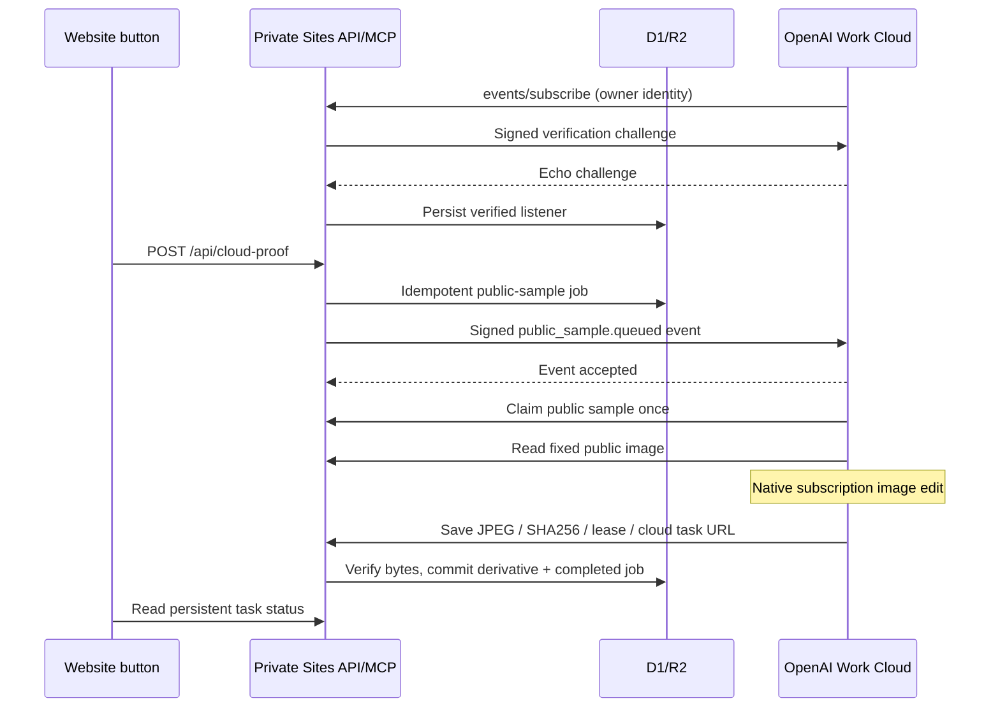

# Website-triggered OpenAI subscription image proof

## Goal and boundary

The owner clicks **Generate public sample** on `/cloud-proof`. The Site commits one public-coffee job and sends an MCP event to an already connected OpenAI Work Cloud listener. The listener claims the job, edits the fixed source with the native subscription image tool and saves actual output bytes through the Site MCP tool. No Mac process, paid API, third-party compute, private-photo input or manual-album write is involved.

An initial, one-time OpenAI event-listener setup is required. Publishing an MCP server does not itself create a listener. A missing/expired listener blocks queue creation with a clear error. Cloud execution, event acceptance and final image storage are separate states; `accepted` does not mean the image was generated.

## Interfaces and state

- MCP advertises `events` in discovery and initialization, and implements `events/list`, `events/subscribe`, `events/unsubscribe`.
- `public_sample.queued` has no user-selectable filters; its payload contains only job ID and the fixed public photo ID `1060`.
- `public_cloud_connection` returns readiness/expiry, never signing secrets or callback URLs.
- `public_sample_image` exposes only the checksum-verified bundled JPEG, not arbitrary photo IDs or the private gallery.
- Existing claim/save tools retain owner checks, one claim, fenced commits, byte verification and idempotent delivery. Provenance accepts native Cloud and Work chat URLs.
- Listener state is one row per owner in `cloud_event_subscriptions`, via append-only migration `0007_new_the_leader.sql`. Secrets stay server-side. Default and maximum granted lifetime is 24 hours; OpenAI must refresh before expiration. Expiration or unsubscribe disables new delivery.
- Only fixed first-party OpenAI HTTPS callback hosts are accepted. Credentials in URLs, custom ports, fragments, arbitrary subdomains/IPs and redirects are rejected. The deployment trusts the fixed first-party domains' DNS; it does not implement a general-purpose callback fetcher or user-selectable URL routing.
- Standard Webhooks HMAC covers event ID, signing timestamp and exact body. Subscription IDs are deterministic. Verification challenges are random, bounded and compared without value-dependent early exit. Successful challenge caching is bounded; key rotation signs with both keys for five minutes.
- The button request awaits delivery, with at most three attempts for transient errors. The event ID/body remain stable across retries. A persisted delivery lease prevents concurrent sends; accepted events are not resent. Failed delivery can be retried from the same button without creating another job or re-running inference. No `waitUntil`, Mac poller, extra queue service or own-account Worker is used for this path.
- One new event-proof work key keeps the prior manually started proof and its image intact. This is still a bounded public-sample acceptance test, not arbitrary-photo production integration.

## Verification

Local protocol tests validate signatures/challenges, origin and redirect rejection, owner authorization, idempotent subscriptions/claims, repeated event delivery and unchanged manual albums. Local SQLite/R2 simulation is not hosted proof.

Hosted acceptance remains pending until the actual plugin discovers the event, OpenAI stores a verified listener, a website click delivers the event, an unattended OpenAI task creates and saves a fresh image, the Site reload/download checks match and the original manual-album rows compare exactly. No manual follow-up may perform the claim/generation on behalf of the event run.

## References

- [Official MCP Events implementation and lifecycle](https://developers.openai.com/plugins/build/mcp-events)
- [Native subscription image generation](https://learn.chatgpt.com/docs/image-generation)
- [Earlier explicitly started cloud round trip](openai-cloud-proof.md)

## Hosted outcome — 2026-11-04 (Hong Kong)

**Not end-to-end accepted.** Site v19 (`5181fb7`) is published owner-private, and the official plugin UI discovers all five tools plus `public_sample.queued`. A normal OpenAI Work Cloud capability check confirmed native image editing and cloud file/checksum tools. However, the official event-task creation interface did not establish a listener.

The Work Cloud verification chat reports these concrete creation outcomes:

1. Two attempts using the exposed declaration's `schedule: ""`, `timing_mode: "condition_watch"` and the exact discovered trigger returned the nested error `The task service returned an unexpected error`. The outer wrapper's `isError: false` was not treated as success.
2. Fresh event discovery says not to provide a schedule, and part of the create description says to omit both timing fields. One controlled attempt omitting both failed at argument binding: `InvalidActionArgumentsError: Missing required tool arguments: timing_mode`.
3. Supplying the required `timing_mode` while still omitting `schedule` then returned `Missing required tool arguments: schedule`.

After every failed creation, the verification chat checked the native task list and the Site's connection tool: no Moment task ID, no duplicate Moment task, and `{"ready":false,"expiresAt":null}`. The normal task-management UI also showed no Moment task; its available creation form exposed clock scheduling only. Existing unrelated tasks were untouched. There was no new queued public job, claim, inference or saved result in this automatic-trigger test. The older manually started successful proof remains a separate result.

The verified blocker is the official creation tool's contradictory timing-field contract and its service errors. No downstream callback reason was returned. Added server diagnostics contain method/phase/origin only; absence of matching log entries is not proof that the downstream subscription was never attempted. Callback verification and event delivery remain unverified online.

The website keeps **Generate public sample** disabled until a real listener is ready. We did not replace this with Mac execution, a timed poller, another cloud service, private endpoint calls, copied subscription credentials, a paid API, or manual generation presented as an event run. All three manual-album rows compare exactly with their pre-change state.

[Evidence record](evidence/2026-11-04-openai-event-trigger.json) and [verification chat](https://chatgpt.com/c/6aea031e-ad80-83ee-a0e8-9e466e237c87). After the official task interface can create a webhook-only listener, resume at subscription readiness, then perform one actual website click and cloud-output/download readback. Do not repeat the image-generation proof manually as a substitute.
