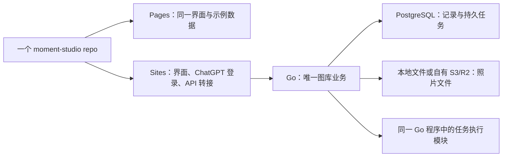

# Sites 入口与 Go 图库：部署和实现设计草案

日期：2026-11-02。状态：用户已确认 PostgreSQL 与 Sites＋云端 Go 优先；业务后端尚未实现或部署。

## 目标与已作决定

用户已选择：一个 GitHub repo；同一套前端用于 GitHub Pages 示例版和真实工作台；Sites 管网站入口，Go 管图库业务。希望同一套业务代码可在本地、Docker 或纯云端运行，长期承载增长的照片，而不重复实现两套后端。

保留当前英文界面、字体与图库／拼图／Style Lab 三个功能入口。继续使用示例图库验收，接真实照片和实时 AI 模型需要后续明确范围。

用户进一步确认：先用 PostgreSQL，第一阶段以 Sites＋云端 Go 为正式交付目标。本地／Docker 保留为开发、测试和后续自托管方式，不要求先交付本地产品再接云端。

以下仍是本稿提出的实现选择，不视为用户已经逐项批准：本地目录与 S3 兼容对象存储两种文件适配；Go 模块化单体；普通 Docker 云主机作为参考云部署；Cloudflare Containers 作为额外部署目标。具体云账户、主机与费用尚未选定。

## 当前代码

- `src/main.jsx` 在 React state 中集中修改整个图库；每次变更把全量状态交给 `src/storage.js` 写入 IndexedDB。
- `src/components.jsx` 将上传文件读为 data URL，限制每批 20 张、单张 12 MiB、JPG/PNG/WebP。
- 分类与组合操作使用已有标签；Style Lab 为预生成结果；拼图在浏览器 Canvas 渲染。
- `.openai/hosting.json` 仅声明静态 `dist`。当前没有 Go 程序、Docker、服务端身份转接或云端图库持久化。
- 本轮不会把旧浏览器数据自动迁入服务器，也不会把整份 state JSON 作为云数据库记录反复覆盖。

## 平台边界

| 运行位置 | Go 业务服务 | 数据持久性与额外条件 |
| --- | --- | --- |
| 本机进程 | 可以 | 本机 PostgreSQL 或 Docker PostgreSQL；照片可用本地目录 |
| 本机／自有服务器 Docker | 可以，使用同一 Go 镜像 | 数据库和照片目录配置独立持久卷 |
| 普通云容器／云主机 | 可以，使用同一 Go 镜像 | PostgreSQL 与对象存储独立配置；无需用户电脑持续开机 |
| 自己账户下的 Cloudflare Containers | 官方支持 Go 容器 | Workers Paid；需单独的 Worker／容器部署配置；磁盘默认临时，外接持久数据服务 |
| 现有 Sites 管理的 Workers 环境 | 没有已确认的原生 Go 容器发布路径 | 继续使用支持的 JS/TS 入口，通过 HTTPS 调用 Go 服务 |

“纯云端”不要求所有服务都属于 Cloudflare。参考方案可以是 Sites + 云端 Go 容器 + 云端 PostgreSQL + 自己账户的 R2。

即使 Go 运行在 Cloudflare Containers，参考方案仍使用外部持久 PostgreSQL 服务，沿用同一数据库与迁移。不同 CPU 环境按目标平台构建镜像，业务源码和 Dockerfile 共用；Cloudflare 当前要求容器可运行于 `linux/amd64`，不能把 Apple Silicon 本地镜像直接视作已适配云端。

如果另外要求“所有组件都由 Cloudflare 提供”，需要重新决定数据库接入方式，例如为 D1 增加受保护的 HTTP 适配。这会增加一套数据库适配及测试，当前不承诺、不作为第一阶段目标。Sites 管理的 D1/R2 也不能默认让外部 Go 服务直接管理。

Cloudflare Containers 是自己账户中的单独资源，不属于现有 Site 自动配置或计费承诺。它是否已在用户账户可用，本轮没有登录验证。

## 方案取舍

1. **Sites 入口 + Go 业务服务（已选择的方向）**：业务逻辑只写一次；Go 使用普通容器，数据资源自己配置。代价是增加一个部署服务和受保护的服务间身份传递。
2. **全部采用 Sites TS + D1/R2**：平台原生部署较集中，但不满足当前选择的 Go 业务核心；不能把这套实现再同时做一遍当作切换版。
3. **把完整 Go 程序移植到 Workers Wasm**：部署链路与原生依赖存在未验证因素，不作为本项目可移植后端的参考路径。

## 职责划分



- **Sites**：托管真实界面、读取平台身份、向 Go 发送经过签名的请求；不写照片表、不创建另一份相册数据库、不复制图库业务。
- **Go**：检查照片所有权、组织分类／相册、管理上传、保存 Style 配方与衍生关系、持久化任务和失败状态。
- **前端**：交互、选片、布局和编辑预览；通过同一业务接口访问 demo 或服务器数据。
- **PostgreSQL**：图库记录、相册关系、上传状态和任务。所有部署沿用同一种数据库和同一套迁移。
- **文件存储**：原图、缩略图、参考图、拼图和 AI 衍生图；数据库只保存对象标识和必要元数据。

起步只做一个 Go 模块、一个业务服务。任务模块与 HTTP 模块逻辑分开，但第一版可在同一进程运行。以后有需要再让同一程序以 API／worker 模式分别启动；不先引入 Redis、独立队列服务、Rust 或 Kubernetes。

本地和云端默认是独立图库。可移植指同一程序能部署到不同位置，不表示两处数据自动同步。切换运行环境通过显式导出／导入迁移数据库、文件和所有者映射；第一版不做双向同步，也不让两套独立 Go 部署同时争用同一份本地文件目录。

## 一个 repo 的建议目录

```text
src/                         保留现有 React 界面，不为架构调整重写布局
src/services/                前端业务调用；demo 与 HTTP 两个数据实现
sites/                       Sites 支持的服务端入口、身份转接和发布适配
server/
  cmd/moment/                Go 程序入口
  internal/                  HTTP、身份、图库业务、文件存储、持久任务
  migrations/                单一 PostgreSQL schema 历史
contracts/openapi.yaml       前后端 API、错误与任务状态约定
deploy/local/                Docker Compose 与持久卷说明
deploy/cloudflare/           验证后加入容器路由与部署适配
docs/                        设计、数据导出与恢复说明
```

目录不是预先全部搭空壳的要求；按第一个完整功能所需逐步添加。保留现有 Site project_id，不创建第二个业务源码 repo。

Pages 通过演示模式构建同一界面，不连接生产 Go 服务。现有资源 URL 多为 `/photos/...` 等根路径，项目型 Pages 部署前必须统一基于构建 base 解析资源地址；私有 repo 的 Pages 套餐资格也需实际确认。

## 三种运行方式

### 完全本地／Docker

浏览器访问本地界面，开发代理或 Go 静态文件服务将 `/api` 发往本地 Go；PostgreSQL 与照片目录使用持久卷。第一阶段先限本机访问，使用明确开启的本地单用户模式；Docker 对外发布端口仅绑定宿主机回环地址。本地身份模拟只用于开发，不进入公开云配置。

如果要求 Docker 直接公开给朋友用，需要另补正常登录／会话方案，不能把本地单用户模式当作公网认证。此功能不属于第一阶段“本机可运行”的承诺。

### Sites + 云端 Go（第一阶段正式交付目标）

Sites 同源 `/api` 入口接收浏览器业务请求并验证身份，转接到云端 Go。Go 后台处理、PostgreSQL 和自有对象存储均在云端，用户电脑关机后仍可使用。

Go 容器保持无状态。普通云容器或自有云主机只需运行同一镜像，并提供数据库、对象存储和身份配置。

### Sites + 本机 Go

Sites 云端无法访问用户电脑上的 `127.0.0.1`。需要另有可达且鉴权的 HTTPS 地址，例如隧道；不能只把 API 地址填成 localhost。

这属于额外的混合部署选项。电脑休眠、关机或断网后图库服务不可用，不能等同于云托管。第一阶段不申请隧道，也不把未经鉴权的本机端口公开。

## 身份和权限边界

Go 使用自己的内部用户 ID；维护平台身份到用户的映射，键包含身份来源、Site project_id 和该 Site 内稳定的用户 ID，避免不同 Site 的 ID 混用。第一版正式模式只允许一个明确绑定的所有者。

Sites 服务端从平台可信上下文读取身份，以短时效、带签发方／接收方和主体的签名令牌调用 Go。采用成熟令牌库，校验算法、有效期、issuer、audience 和允许的 Site；密钥仅放双方服务端配置，可轮换。精确令牌格式在身份接入阶段冻结并纳入契约测试。

Go 不信任浏览器自行提交的 `oai-authenticated-user-id` 或其他用户 ID。每次读取、下载、上传完成、相册修改和任务查询都检查资源所有权。Sites 页面私有不代表独立 Go 地址天然私有。

Sites 平台的服务访问 bearer token 不提供访客身份，不能代替上述用户认证。本地单用户模式与生产 Sites 身份模式显式区分，生产缺少身份密钥时拒绝启动，不静默回退本地用户。

## 文件与业务状态

核心实体：用户、媒体资源、文件对象、分类、相册及有序成员、Style 及版本、处理任务、上传会话。原图对象不可覆盖；处理结果记录父资源、Style 版本、参数和实际生成来源。

不要将全部图库文件或状态一次加载到浏览器。列表采用稳定游标分页与缩略图；详情按需读取预览图／原图。日期和用户过滤建立必要索引，图像字节不进入数据库。

上传采用显式会话：`created → uploading → verifying → processing → ready`；错误与取消另外记录。接口按用户和幂等键防止重试生成重复记录。首个垂直功能使用小型示例 JPG/PNG/WebP 验证流式上传，再加入分片、进度和恢复能力。

本地文件适配与 S3/R2 适配遵守同一业务状态约定，但各自实现写入／分片／完成／取消；不假设二者底层 API 一样。云端优先验证 Go 对象存储客户端流式上传，浏览器直传使用短时效、对象范围受限的签名地址时再加入；绝不把永久对象存储凭据发给前端。

对象存储完成和数据库提交不能当成跨系统事务。只有服务端确认对象存在、大小与校验结果符合要求，才推进照片状态；超时可恢复检查。未完成分片和孤立对象需要宽限期、可审计的清理策略，实现前验证具体 provider 的行为。任何清理操作均须遵守项目文件删除政策。

不要单凭客户端提供的 hash 承诺去重。服务端验证内容指纹，用户范围内处理重复导入；保留原始文件名和导入记录。上传第一阶段的成功不代表已实现 iCloud 全量同步。

后台任务持久化在 PostgreSQL。执行采用有限并发、租约与重试；进程重启后恢复过期租约任务。状态明确区分等待、运行、成功和失败；重试采用幂等结果键，不重复创建衍生资源。后续真实模型调用需单独处理供应商幂等和结果对账，不承诺外部调用恰好执行一次或绝不重复扣费。

HEIC、Live Photo 与视频不混作普通 JPG 支持。第一阶段保持当前格式范围并显示明确限制；iPhone 接入阶段验证保留原图、HEIC 预览、Live Photo 的照片／视频配对及 EXIF。元数据缺失时保留未知值，不把文件修改时间伪装成拍摄时间。

## 分阶段实现与验收

| 阶段 | 交付 | 必须看到的结果 |
| --- | --- | --- |
| 0. 现有前端同步 | 将 GitHub main 中的当前英文原型发布到现有私有 Site | 核对 GitHub commit 与 Sites 部署版本；不把前端发布当成 Go 后端已接通 |
| 1. Sites＋云端 Go 完整流程 | Sites 身份网关、Go 正式鉴权、PostgreSQL、自有云对象存储、上传／列表／预览、人工分类和相册接口 | 在 Sites 上传示例图→分类／加入相册→刷新或另一授权会话仍可读；Go 重启保留数据；非所有者无法访问；用户电脑关机后云端仍可用 |
| 2. 可靠图库 | 上传会话和恢复、重复导入、缩略图持久任务、游标分页、导出及恢复流程 | 中断重试不重复建照片；处理失败可见；进程终止后任务恢复；大列表不全量读原图 |
| 3. 本地／Docker 自托管交付 | 同一 Go 业务代码、本地文件适配、持久卷和启动说明 | 完全本地运行与重启持久化可验收；本地身份模式与云端正式鉴权隔离；不依赖 Sites 即可开发和测试 |
| 4. 创作持久化 | 保存拼图、Style 版本、参考图和衍生关系；继续明确区分预生成样例 | 同一 Style 可复用；原图保留；未接模型时不显示假生成成功 |
| 5. 可选部署与照片源 | Cloudflare Containers 验证、iPhone 格式和手动导入体验 | 同一 Go 业务代码可换主机；证实无临时磁盘依赖；真实格式和来源单独验收 |

阶段 1 必须验收云端持久化、私有访问与独立 Go 部署；不会以“本地跑通”或“Sites 前端部署成功”代替。它仍不代表大图库容量与全部恢复场景验收通过。首次真实图库接入前，至少完成上传恢复、私有访问、原图导出及一次数据库＋文件恢复演练。

Cloudflare Containers 的上线还需要验证休眠／重启、任务租约、唤醒策略、数据库连接上限和首次启动响应。不能把一个依赖常驻循环的后台任务直接放进去就假设无人访问时仍会运行。

## 设计审阅

独立实现者审阅认为可以据此进入实现规划，没有必须先补问用户的阻塞项。审阅后补充了两条默认值：Cloudflare 容器方案仍沿用外部 PostgreSQL；本地和云端图库默认独立，迁移使用显式导出／导入。审阅不代表运行、上传或部署验证已经通过。

## 当前不实施的内容

本稿不创建云账户或收费资源，不创建新 Site，不更改访问名单，不接真实图库，不配置模型密钥。现有前端可单独同步到既有私有 Site；这不代表 Go 接入完成。目前没有创建 Go 工程、容器或数据库，也没有验证上传吞吐量或用户账户 Cloudflare Containers 权限。

## 官方与本地依据

- [Cloudflare Containers 概览：Workers Paid、独立容器部署](https://developers.cloudflare.com/containers/)
- [Cloudflare 官方 Go 容器入门](https://developers.cloudflare.com/containers/get-started/)
- [容器生命周期：磁盘默认临时、休眠后重新启动](https://developers.cloudflare.com/containers/concepts/architecture/)
- [Sites skill：运行约束与发布入口](/Users/von/.codex/plugins/cache/openai-curated-remote/sites/1.1.2/skills/sites/SKILL.md)
- [Sites 身份规则](/Users/von/.codex/plugins/cache/openai-curated-remote/sites/1.1.2/skills/sites/references/identity-and-secrets.md)
- [上一轮能力和费用核查](/Users/von/Documents/Codex/2026-10-20/sites-plugin-sites-openai-curated-remote/outputs/backend-research-2026-11-02.md)
